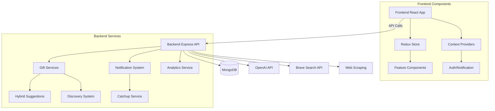
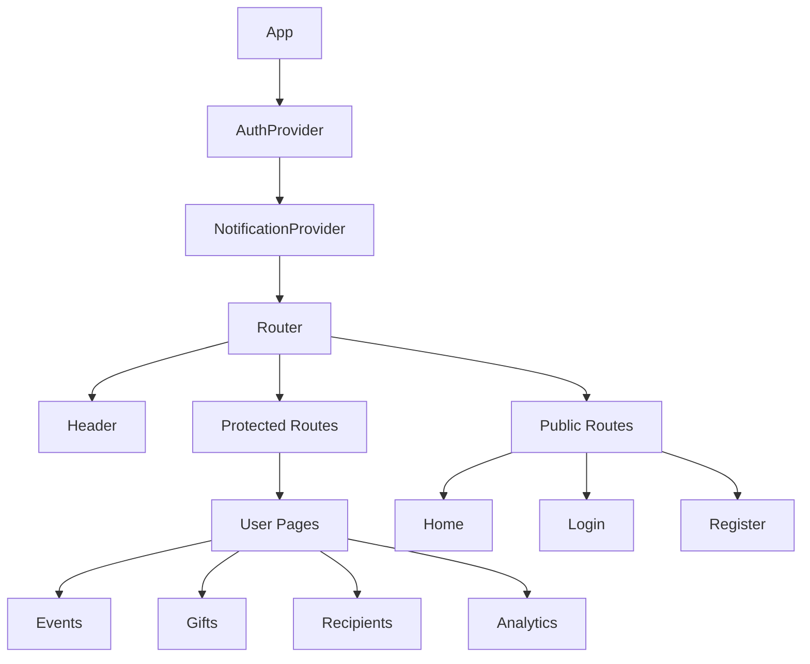
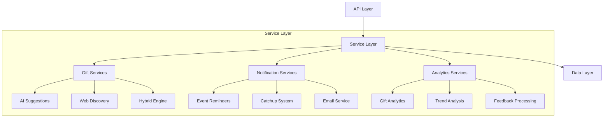
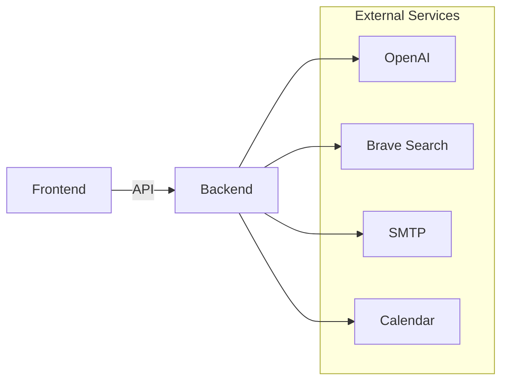
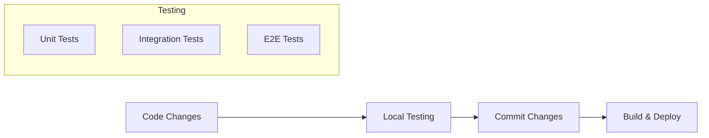
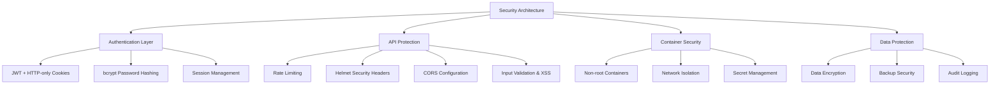
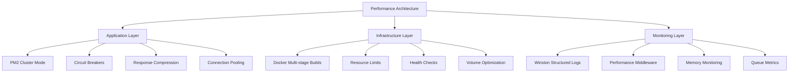

# Gifty — Development Guide

> **Current workflow (0.9.0+).** Sections further down predate the self-host packaging and still mention PM2, nginx and `scripts/docker-setup.sh`, which no longer exist. Use these commands:
>
> ```bash
> docker compose -f docker-compose.dev.yml up -d      # MongoDB + Redis on localhost (MONGO_IMAGE=mongo:4.4 on CPUs without AVX)
> cd gifty-backend && npm install && npm run dev      # API on :5000 (nodemon)
> cd gifty-frontend && npm install && npm start       # UI on :3000
> docker build -t gifty:dev . && ./scripts/smoke-test.sh   # build + smoke-test the self-host image
> ```
>
> The backend runs as a single Node process; scheduled jobs live in `gifty-backend/services/schedulerService.js`.

---

# Gifty - Gift Management Application

Gifty is a comprehensive gift management application designed to help users organize, track, and plan gifts for various occasions. The application provides features for managing recipients, events, budgets, and gift suggestions, making it easier to keep track of gift-giving throughout the year.

## 📱 Project Overview

Gifty takes the stress out of gift-giving with an intuitive interface for managing gifts, events, recipients, and budgets. It consists of a React frontend and Node.js/Express backend, running in a Docker container environment.

## ✨ Key Features

- **AI-Powered Gift Suggestions**: Get personalized gift ideas based on recipient preferences using OpenAI's GPT-4o (configurable in gifty-backend/config/aiConfig.js)
- **Multi-Source Gift Discovery System**: Continuously discovers and curates gifts from across the web
- **Hybrid Suggestion Engine**: Combines discovered gifts with AI-generated recommendations for maximum variety
- **Gift Management**: Track gift ideas, purchases, and history
- **Event Tracking**: Never miss an important date with calendar integration
- **Budget Planning**: Set spending limits and track your gift budget
- **Recipient Management**: Create detailed profiles with preferences and interests
- **Smart Notifications**: Get timely reminders for upcoming events
- **Feedback Collection**: Rate and review gift suggestions to improve future recommendations
- **Budget Analytics**: Visualize spending patterns and budget allocation
- **User Authentication**: Secure account creation and login system
- **Gift Explorer**: Browse through thousands of curated gifts with advanced filtering

## 🚀 Technology Stack

### Frontend
- **React** (v18.3.1): Core UI library
- **React Router** (v6.24.1): Navigation and routing
- **Redux Toolkit**: Global state management
- **Context API**: Authentication and notification state
- **Axios**: API communication
- **Tailwind CSS**: Utility-first styling
- **Chart.js/react-chartjs-2**: Data visualization
- **FullCalendar**: Calendar views and event management
- **React Hook Form**: Form handling and validation
- **React-Toastify**: Toast notifications

### Backend
- **Node.js**: Runtime environment
- **Express.js**: Web application framework
- **MongoDB with Mongoose**: Database and ODM
- **JWT**: Authentication and authorization
- **bcryptjs**: Password hashing
- **helmet**: HTTP security headers
- **express-rate-limit**: API rate limiting
- **multer**: File upload handling
- **nodemailer**: Email functionality
- **winston**: Structured logging
- **OpenAI API**: AI-powered gift suggestions
- **Brave Search API**: Web search integration
- **Cheerio**: Web scraping
- **node-cron**: Task scheduling
- **similarity**: String comparison for deduplication

### Infrastructure & Production Readiness
- **Docker**: Full containerization with Docker Compose orchestration
- **Multi-stage builds**: Optimized container images with security features
- **Health monitoring**: Comprehensive liveness, readiness, and detailed health endpoints
- **Enterprise logging**: Winston-based structured logging with PM2 integration
- **Database backup/restore**: Automated MongoDB backup system with Docker integration
- **Circuit breakers**: OpenAI and Brave Search circuit breakers for resilience
- **PM2 cluster mode**: Container-aware process management with graceful shutdowns
- **Security**: Non-root containers, network isolation, comprehensive security headers
- **Deployment automation**: Professional deployment scripts with health checks and rollback
- **Performance monitoring**: Memory monitoring, rate limiting, and performance middleware
- **Queue management**: Bull queues for background job processing with monitoring

## 🗂️ Project Structure and Architecture

### System Architecture



### Frontend Architecture (`/gifty-frontend`)

```
gifty-frontend/
├── public/                 # Static files and index.html
├── src/                    # Source code
│   ├── assets/             # Images, icons, and sounds
│   │   └── sounds/         # Notification audio files
│   ├── components/         # Reusable UI components
│   │   ├── analytics/      # Analytics and visualization
│   │   ├── css/           # Component styles
│   │   ├── forms/         # Form components
│   │   │   ├── css/       # Form styles
│   │   │   └── js/        # Form logic
│   │   ├── GiftExplorer/  # Gift discovery components
│   │   ├── js/            # General components
│   │   └── ui/            # UI elements
│   ├── pages/             # Page components
│   │   ├── css/           # Page styles
│   │   └── js/            # Page logic
│   ├── utils/             # Utility functions
│   ├── slices/            # Redux slices
│   ├── App.js             # Main component
│   ├── AuthContext.js     # Auth provider
│   ├── NotificationContext.js # Notification provider
│   ├── ProtectedRoute.js  # Route protection
│   ├── axiosInstance.js   # API client
│   ├── store.js           # Redux config
│   └── index.js           # Entry point
├── .env                   # Environment config
├── package.json           # Dependencies
├── tailwind.config.js     # Tailwind config
└── config-overrides.js    # Build config
```

### Component Hierarchy



### Backend Architecture (`/gifty-backend`)

```
gifty-backend/
├── config/             # Configuration
├── controllers/        # API handlers
├── middleware/         # Custom middleware
├── models/            # Data models
├── routes/            # API routes
├── services/          # Business logic
│   ├── aiService.js           # Basic suggestions
│   ├── enhancedAiService.js   # Advanced suggestions
│   ├── giftDiscoveryService.js# Web discovery
│   ├── hybridSuggestionService.js # Hybrid engine
│   ├── notificationService.js # Notifications
│   ├── catchupService.js     # Notification recovery
│   ├── emailService.js       # Email delivery
│   ├── cleanupService.js     # Maintenance
│   ├── trendAnalysisService.js # Gift trends
│   └── webSearchAiService.js # Search enhancement
├── schedulers/        # Background jobs
│   └── discoveryScheduler.js # Gift discovery
├── utils/             # Utilities
├── uploads/           # File storage
├── logs/             # System logs
├── docs/             # Documentation
├── migrations/        # DB migrations
├── tests/            # Test files
└── server.js         # Entry point
```

### Service Architecture



## 🔌 API and Service Integration

### API Endpoints

The backend provides a comprehensive RESTful API:

| Endpoint | Description | Key Features |
|----------|-------------|--------------|
| `/api/users` | User management | - Registration/authentication<br>- Profile management<br>- Session handling |
| `/api/budgets` | Budget tracking | - Budget creation/tracking<br>- Spending analytics<br>- Status monitoring |
| `/api/events` | Event management | - Event creation/tracking<br>- Calendar integration<br>- Holiday system |
| `/api/gifts` | Gift management | - Gift tracking<br>- Purchase status<br>- History management |
| `/api/gift-library` | Gift discovery | - Hybrid suggestions<br>- Web-discovered gifts<br>- AI recommendations |
| `/api/recipients` | Recipient management | - Profile management<br>- Preference tracking<br>- Gift history |
| `/api/notifications` | Notifications | - Event reminders<br>- Catchup system<br>- Email delivery |
| `/api/email-config` | Email settings | - SMTP configuration<br>- Provider setup<br>- Test functionality |
| `/api/settings` | App settings | - User preferences<br>- System configuration<br>- Integration settings |

### Service Integration Architecture



## 📦 Production Deployment & Development

### Production-Ready Features

#### Health Monitoring
- **Liveness Probe**: `/api/health/liveness` - Basic service availability
- **Readiness Probe**: `/api/health/readiness` - Database and Redis connectivity
- **Detailed Health**: `/api/health/detailed` - Complete system metrics, circuit breaker status, memory usage, queue statistics (signed in as the instance owner)

#### Enterprise Logging
- **Winston-based logging**: Structured JSON logs with multiple levels
- **Container optimization**: Logs to stdout/stderr for Docker log collection
- **PM2 integration**: Process-level logging with automatic log rotation
- **Request logging**: Comprehensive API request/response logging
- **Performance monitoring**: Memory usage, response times, and system metrics

#### Database Management
- **Automated backups**: MongoDB backup system with Docker integration
- **Backup scheduling**: Configurable backup intervals with cleanup
- **Restore functionality**: One-command database restoration
- **Data persistence**: Docker volumes for reliable data storage

#### Security & Resilience
- **Circuit breakers**: Automatic failover for external API dependencies
- **Rate limiting**: API endpoint protection against abuse
- **Security headers**: Comprehensive HTTP security headers via helmet
- **Input validation**: XSS protection and data sanitization
- **Non-root containers**: Security-hardened Docker containers

### Prerequisites
- Docker Engine 20.10+
- Docker Compose v2.0+
- 4GB+ RAM, 10GB+ disk space
- OpenAI API key (for AI features)
- Brave Search API key (for gift discovery)
- SMTP server access (for notifications)

### Production Deployment

#### Quick Production Setup
```bash
# Clone repository
git clone <repository-url>
cd gifty

# Setup environment (REQUIRED)
cp .env.example .env
# Edit .env with your production configuration

# Automated production deployment
./scripts/docker-setup.sh setup

# Access applications
# Frontend: http://localhost:3000
# Backend API: http://localhost:5000/api
# Health Check: http://localhost:5000/api/health
# Detailed Health (instance owner only): http://localhost:5000/api/health/detailed
```

#### CI/CD Deployment
```bash
# Set required environment variables
export FRONTEND_IMAGE=your-registry/gifty-frontend:v1.0.0
export BACKEND_IMAGE=your-registry/gifty-backend:v1.0.0
export BUILD_NUMBER=123
export GIT_SHA=abc123

# Deploy with health checks and rollback capability
./scripts/deploy.sh deploy

# Monitor deployment status
./scripts/deploy.sh status

# View application logs
./scripts/deploy.sh logs

# Rollback if needed
./scripts/deploy.sh rollback
```

**Required Environment Variables:**
```bash
# Security (REQUIRED - generate strong secrets)
SESSION_SECRET=your_strong_session_secret_minimum_32_characters_long
JWT_SECRET=your_strong_jwt_secret_minimum_32_characters_long
COOKIE_SECRET=your_strong_cookie_secret_minimum_32_characters_long
REDIS_PASSWORD=your_strong_redis_password

# API Keys (REQUIRED for AI features)
OPENAI_API_KEY=your_openai_api_key_here
BRAVE_SEARCH_API_KEY=your_brave_search_api_key_here

# Email Configuration (for notifications)
DEFAULT_EMAIL_USER=your_email@gmail.com
DEFAULT_EMAIL_PASSWORD=your_app_password
DEFAULT_EMAIL_FROM_NAME="Gifty Notifications"

# Production Configuration
NODE_ENV=production
LOG_LEVEL=info
INSTANCE_ID=gifty-production-1
```

### Local Development

**Prerequisites:**
- Node.js 18+ and npm
- MongoDB 4.4+
- Redis 6.2+

**Setup:**
```bash
# 1. Infrastructure
docker-compose up -d mongodb redis

# 2. Backend Setup
cd gifty-backend
npm install
cp .env.example .env
# Edit .env with your configuration
npm run db:init
npm start

# 3. Frontend Setup
cd gifty-frontend
npm install
npm start
```

### Environment Configuration

#### Backend (.env)
```ini
PORT=5000
MONGO_URI=mongodb://localhost:27017/gifty
JWT_SECRET=your_jwt_secret
OPENAI_API_KEY=your_openai_api_key
BRAVE_API_KEY=your_brave_api_key
DISCOVERY_INTERVAL=3600000
SMTP_HOST=smtp.example.com
SMTP_PORT=587
SMTP_USER=your_email
SMTP_PASS=your_password
```

#### Frontend (.env)
```ini
REACT_APP_API_BASE_URL=http://localhost:5000
```

### Docker Deployment Management

### Container Management & Monitoring

#### Development Mode
```bash
# Uses docker-compose.override.yml (default)
docker-compose up -d

# Features:
# - Debug logging enabled
# - Development environment variables
# - Redis Commander UI available (port 8081)
# - Node.js debugging port exposed (9229)
# - Hot reload for development
```

#### Production Mode
```bash
# Production configuration
docker-compose -f docker-compose.yml -f docker-compose.prod.yml up -d

# Features:
# - PM2 cluster mode with multiple instances
# - Resource limits and optimization
# - Enhanced security settings
# - Production volume mounts
# - Container health checks
# - Structured logging to stdout/stderr
```

#### Service Management
```bash
# Automated service control
./scripts/docker-setup.sh {setup|start|stop|restart|status}

# Advanced deployment management
./scripts/deploy.sh {deploy|status|health|logs|rollback}

# Container monitoring
./scripts/docker-setup.sh logs [service_name]
docker-compose ps
docker stats

# Database backup/restore
curl -X POST http://localhost:5000/api/database/backup
curl -X POST http://localhost:5000/api/database/restore

# Health monitoring
curl http://localhost:5000/api/health/liveness
curl http://localhost:5000/api/health/readiness
curl -H "Authorization: Bearer $OWNER_TOKEN" http://localhost:5000/api/health/detailed

# Environment testing
./scripts/test-containerized-environment.sh [test_category]

# Cleanup
./scripts/docker-setup.sh clean
```

#### Service URLs & Monitoring

| Service | URL | Description |
|---------|-----|-------------|
| **Application** |
| Frontend | http://localhost:3000 | React application |
| Backend API | http://localhost:5000/api | REST API endpoints |
| **Health Monitoring** |
| Liveness Probe | http://localhost:5000/api/health/liveness | Basic availability check |
| Readiness Probe | http://localhost:5000/api/health/readiness | Service dependencies |
| Detailed Health | http://localhost:5000/api/health/detailed | Complete system metrics (instance owner) |
| **Development Tools** |
| Redis Commander | http://localhost:8081 | Redis management (dev only) |
| **Database Management** |
| Backup API | POST /api/database/backup | Create database backup |
| Restore API | POST /api/database/restore | Restore from backup |
| List Backups | GET /api/database/backups | View available backups |

### Development Workflow



#### Containerized Development
```bash
# Start containerized environment
./scripts/docker-setup.sh setup

# Run tests in containers
./scripts/test-containerized-environment.sh all

# Monitor services
docker-compose ps
docker-compose logs -f [service]
```

#### Local Development
```bash
# Terminal 1 - Backend
cd gifty-backend
npm start

# Terminal 2 - Frontend
cd gifty-frontend
npm start
```

## 🔒 Security, Performance & Monitoring

### Production Security Features



#### Authentication & Authorization
- JWT-based authentication
- Secure password hashing (bcrypt)
- Role-based access control
- Protected routes
- Session management
- Token refresh mechanism

#### API Security
- Request rate limiting
- CORS configuration
- HTTP security headers (helmet)
- Input validation
- SQL injection protection
- XSS prevention
- CSRF protection

#### Data Protection
- Encrypted sensitive data
- Secure password storage
- File upload validation
- Data backup system
- Audit logging

### Production Performance & Monitoring



#### Application Performance
- **PM2 Cluster Mode**: Multi-process scaling with automatic load balancing
- **Circuit Breakers**: Automatic failover for OpenAI and Brave Search APIs
- **Response Compression**: gzip compression for API responses
- **Connection Pooling**: Optimized MongoDB connection management
- **Memory Management**: Automatic process restart at 1GB memory limit
- **Background Processing**: Bull queues for async operations

#### Container Optimization
- **Multi-stage Builds**: Minimal production images with security scanning
- **Resource Limits**: CPU and memory constraints for stable operation
- **Health Monitoring**: Automated health checks with restart policies
- **Volume Persistence**: Optimized data storage with backup integration
- **Network Isolation**: Secure container networking

#### Monitoring & Observability
- **Structured Logging**: JSON logs with correlation IDs and context
- **Performance Metrics**: Request timing, memory usage, and throughput
- **Error Tracking**: Comprehensive error logging with stack traces
- **Health Dashboards**: Real-time system status via health endpoints
- **Queue Monitoring**: Background job status and performance metrics
- **Database Metrics**: Connection pool status and query performance

## 📊 Enhanced Features

### Multi-Source Gift Discovery System
- Continuous discovery of gifts from across the web
- Automated scraping and classification
- Popularity score tracking
- Deduplication using similarity scoring
- 1000+ gifts discovered per day

### Hybrid Suggestion Engine
- Combines discovered gifts with AI recommendations
- 70% discovered + 30% AI-generated mix
- Recipient profile matching
- Diversity algorithm for varied suggestions
- Fallback to AI for niche requests

### AI Gift Suggestions
- Powered by OpenAI's GPT-4o (configurable in gifty-backend/config/aiConfig.js)
- Structured recommendations with detailed descriptions
- Category tagging and relevance scoring
- Price range accuracy and purchase sources
- Balances budget constraints with gift suitability

### Gift Explorer
- Browse through thousands of curated gifts
- Advanced filtering by category, price, and tags
- Infinite scroll for seamless browsing
- Source indicators (discovered vs AI)
- Trending gifts section

### Analytics Dashboard
- Discovery metrics and system health
- User engagement tracking
- Category performance analysis
- Budget utilization visualization
- Feedback effectiveness metrics

### Budget Analytics
- Visualization using Chart.js
- Pie charts for allocation, bar graphs for spending
- Status monitoring (Normal, Warning, Critical)
- Multi-currency support
- Summary statistics for financial planning

### Machine Learning Enhancement
- Feedback collection for gift suggestions
- Trend analysis for improved recommendations
- Personalization based on user preferences
- Constraint validation for gift suggestions

## 🤝 Contributing

1. Fork the repository
2. Create a feature branch: `git checkout -b feature-name`
3. Commit your changes: `git commit -m 'Add some feature'`
4. Push to the branch: `git push origin feature-name`
5. Submit a pull request

## 📄 License

This project is licensed under the MIT License - see the LICENSE file for details.
